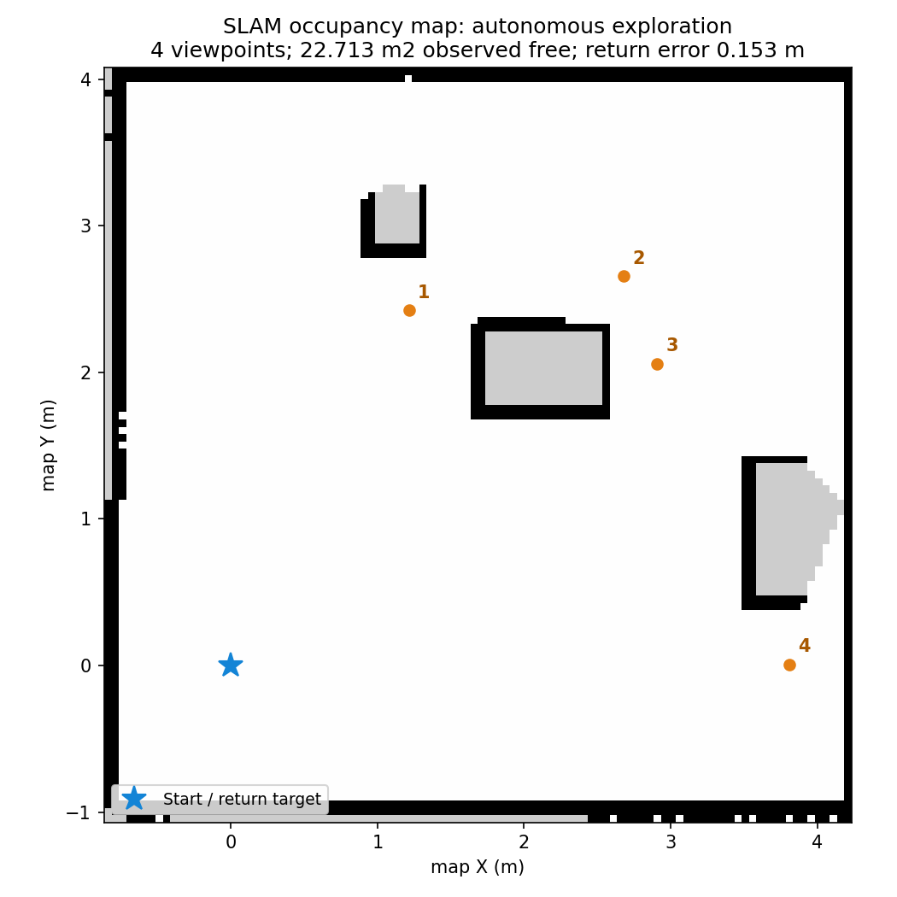

# 地图与实验数据

这里维护数据索引和实验说明。大文件写入 WSL 的 Linux 文件系统，实际占用 D 盘。

| 数据 | Linux 路径 |
| --- | --- |
| 地图、地图参数和参考方向 | `/home/wheeltec/wheeltec_sim_ws/data/maps` |
| ROS 录包 | `/home/wheeltec/wheeltec_sim_ws/data/bags` |
| 各次实验的配置、指标、截图和日志 | `/home/wheeltec/wheeltec_sim_ws/data/runs` |

Windows 资源管理器入口：`\\wsl.localhost\WHEELTEC-Ubuntu-22.04\home\wheeltec\wheeltec_sim_ws\data`。

每次实验使用 `YYYYMMDD-HHMMSS_场景名` 目录名，记录场景、软件版本或提交、使用参数、起点与目标、随机种子（使用时）、数据位置、完成状态及误差/耗时等指标。地图同时记录参考方向定义和坐标约定。

可复现实验的小样例可纳入项目。生成的录包、编译缓存和大体积日志保留在上述 Linux 目录。

## 当前实验索引

| 实验 | 项目中的结果摘要 | 完整数据 |
| --- | --- | --- |
| 房间传感器、前进、停止、转向 | [room-result.json](../setup/verification/room/room-result.json) | 结果中的 run_dir |
| 建图四目标、保存、重启 AMCL 后一目标 | [导航结果](../setup/verification/navigation/result.json) | 结果中的 run_dir |
| 自主探索、保存地图和位姿图、返回起点 | [探索结果](../setup/verification/exploration/result.json) | 结果中的 run_dir |
| 新增箱子绕行、封路停车、取消、固定地图不变 | [障碍结果](../setup/verification/obstacles/result.json) | 结果中的 run_dir |
| 五类布局13组及真值修复后两组重跑 | [结果表](../setup/verification/unknown_rooms/matrix.md) | Linux data/runs/20261023-validation-suite-final、20261024-validation-truth-reruns |
| 普通探索录制、手动存图、同场景AMCL重启 | [普通入口结果](../setup/verification/unknown_rooms/normal-session.json) | Linux data/runs/20261024-normal-session-check，过程目录见capture_run |

手动保存按 `maps/年月日-时分秒-微秒/room` 建目录；自主探索用 `maps/年月日-时分秒_explore/room`。每张地图包含 `.yaml` 地图参数、`.pgm` 栅格图像、`.posegraph`/`.data` 位姿图，以及 `.metadata.json` 参考方向和来源。`maps/latest.json` 指向最近保存地图，启动已存地图导航时读取其中的 `map_yaml`。

参考方向 `reference_yaw_rad` 是相对 map +X 的逆时针弧度，默认0；显示车头相对参考方向时应计算两者角度差并归一到 [-π,π]。它随地图保存，不等同地理正北。

功能检查用 `runs/` 下独立目录保存地图和日志，并设置 `update_latest=false`，保持用户最近地图选择。自主探索检查加 `--record` 时录制 rosbag；不录包也会保存 `process.json`。图形截图在 `../setup/verification/room/`；早期环境日志在 Linux `/home/wheeltec/simulation-checks/`。

[小地图样例](samples/room-25m2/map.yaml) 来自20261022-203127自主探索实验；PGM和元数据一同保留。使用时将 map.yaml 路径传给定位模式，位姿图仍在原始实验目录。



橙色数字是依次下发的探索目标，蓝星是起点；图中没有绘制实际行驶轨迹。灰色为尚未观测区域，包括障碍物内部和少量边缘碎片。

## 陌生房间的记录

新验证说明见 [validation.md](../simulation/validation.md)。批次完整数据写入 Linux `data/runs/20261023-validation-suite-final/`，每种布局和起点占一个子目录；`summary.json` 汇总，原始失败与通过记录均保留。受真值采集阻塞影响的组在新的重跑目录复测，原始失败不覆盖。所有尝试和最终采用结果见 [验证记录](../setup/verification/unknown_rooms/README.md)。项目中只放小型结果摘要与截图。

| 文件 | 内容 |
| --- | --- |
| `process.json` | 按时间保存的估计地图、激光、位置朝向、已走轨迹、规划路线、任务状态 |
| `truth.json` | 单独保存的仿真真值与采样质量，仅供评分 |
| `truth-samples.jsonl` | 独立采集进程逐行落盘的保留测量样本，含源时间戳和实际到达时间 |
| `result.json` | 任务结束状态、覆盖率、墙面误差、返航误差、几何重叠、源码哈希和退出状态 |
| `bag/` | 加 `--record` 后生成的 ROS 原始消息录包 |
| `map.*` | 本次实验实际保存的地图、位姿图、参考方向 |

`completed` 是探索模块自身的任务结论；`acceptance` 才列出独立验收项。覆盖率分母是该起点可达的安全车体中心区域，并非房间总面积。墙面误差分别计算两个方向的95分位，取较大值；未知区域不算空地。真值断流、时间无效或采样间隙过大时，返航与安全评分不能通过。

回放录包时先加载 ROS，再使用独立通信域，避免和正在运行的仿真混合：

```bash
source /opt/ros/humble/setup.bash
export ROS_DOMAIN_ID=87 ROS_LOCALHOST_ONLY=1
RUN=/home/wheeltec/wheeltec_sim_ws/data/runs/某次实验
ros2 bag info "$RUN/bag"
ros2 bag play "$RUN/bag" --qos-profile-overrides-path "$RUN/bag-qos.yaml"
```

这里播放的是已记录的输入和输出。若要用同一包重新运行 SLAM，需要排除旧 `/map`、旧规划/任务输出，并过滤旧 `map→odom` 变换，避免两套算法同时发布定位结果。

迁移到实车时复用源码、接口和配置模板；在陌生实房中从空白地图重新建图。仿真房间地图不作为新实房的地图。