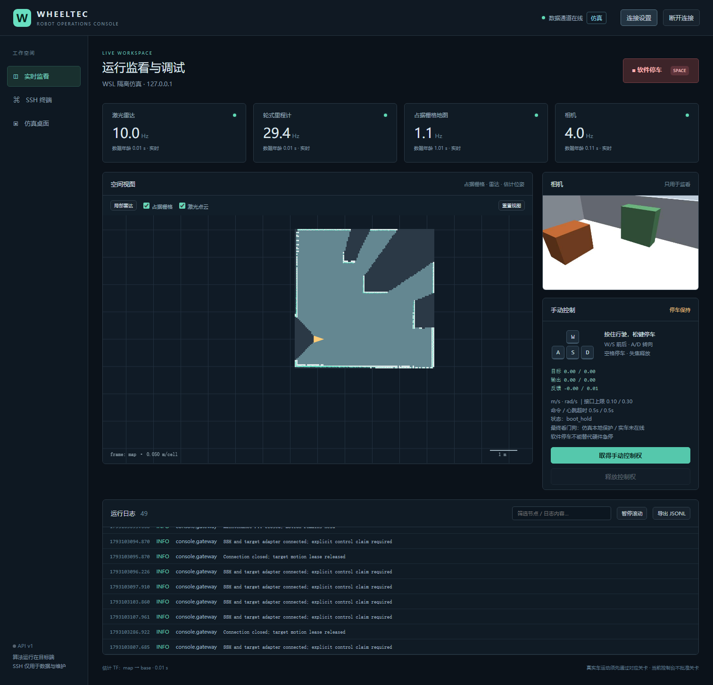
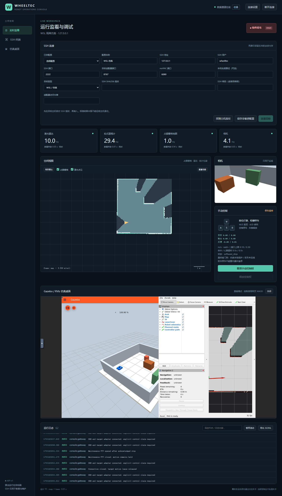

# 网页调试与控制终端验证（2026-10-27）

本轮完成终端实现与真实仿真数据接入，**运动验收未通过，不建议进入实车运动关卡**。没有连接或部署真实小车，没有通过任何 G0–G5 关卡。历史算法的 realism=on 0/75、噪声扫描0/20保持原样，本报告不是建图算法通过率。

## 改动与实际界面

新增 console/ 的 React/TypeScript/xterm.js 前端、FastAPI/Paramiko本机网关、目标端ROS适配器、接口定义和面板注册示例。连接需主机指纹；密码/令牌仅在进程或当前页面内存中。目标端默认只读，独立安全链由已有 preflight、smoother、collision_monitor 和最终watchdog约束。新增车端手动launch及只读systemd模板，均未安装启动。

地图/雷达按TF对齐，支持缩放、平移和图层；相机过期隐藏，TF按源时间和接收时间检查。ROS日志与工具管理的连接/PTY事件可筛选、暂停、导出。维护终端是实际SSH PTY，启用前要求停车且与遥控互斥。完整shell不受网页运动接口限制，不能作为安全沙箱。noVNC通过SSH转发真实Gazebo/RViz，只读，不改Ogre、GPU或雷达三垂直线方案。





相机是测试夹具额外创建的Gazebo固定观察相机，640×480、配置10Hz；截图与网页显示的是实际运行的数据，非演示数据，不代表实车相机规格或安装位置。图中实时频率来自收到的源时间戳，视频适配器另有压缩/限频。

## 最终结果

| 检查 | 通过/总数 | 说明 |
| --- | --- | --- |
| 后端纯逻辑/HTTP认证/SSH传输/数据转换 | 25/25 | 指纹拒绝、跨源拒绝、凭据不落配置、独占租约/过期停车、异步解锁确认、TF接收年龄 |
| 前端键盘与状态逻辑 | 6/6 | 组合键、释放和输入焦点 |
| 既有车端安全回归 | 5/5 | 启动保持、心跳/命令超时、急停、关卡预检 |
| TypeScript检查与生产构建 | 通过 | npm run build |
| npm audit | 0项已知漏洞 | 2026-10-27执行，不能代表未来无漏洞 |
| ROS手动launch参数解析 | 通过 | 只执行 --show-args，不启动节点 |
| shell/编译/systemd静态检查 | 见检查记录 | 不代替真实部署 |
| 最终真实仿真浏览器验收 | **9/12（75%）** | realism=on、room/start0、seed0、域87，无重试 |

最终12项中，通过9项：真实scan/map/video/canvas、输入框释放、失焦停车、后台停车、真实PTY命令执行及互斥、断开/重连保持、noVNC实际画面、仿真停更、适配器停更。失败3项：W达到0.1m/s输出、A达到0.3rad/s输出（两项错误上下文均为 `laser_obstacle_hold`）；多客户端用例中第二客户端请求被拒绝，但原持有者随后发生 `operator_timeout`，未满足持续持有断言。安全链按超时停车，没有为通过测试延长0.5s期限；其浏览器焦点/负载/请求排队根因未验证。包含空格的转向用例在达到转向速度前即失败，因此不能据此声称“运动中空格制动”通过。已有零速保持下的失焦/断链测试，也不能等同于有速度时的实测制动距离。

独立评估仅由测试进程读取Gazebo原生真值，不进入网页、SLAM或控制。发布批次记录6480个真值样本、4352个命令样本，JSON无坏行；真值worker解析错误/丢样均0、native返回0。该记录窗口内最大位移 **0.017608m**、最大朝向变化 **0.103448rad**，指令峰值0.088m/s、0.3rad/s，执行器峰值0.072m/s、0.3rad/s。有短暂运动后保护停车；转向曾出现瞬时0.3rad/s峰值，但浏览器断言未观测到稳定输出，仍记失败，不能报告完整前进/转向成功。原始数据和诊断均保留。

停止保护没有降阈值，也没有删除雷达端点。早期同seed原始scan70/70帧在末端539出现range_min=0.08m，现实化后的69帧中37帧出现相同近点；off模式也观察到末端719的0.08m。最终失败上下文确认近点保护触发，但没有在每个失败瞬间保存逐束原始消息与浏览器事件的同步关联，具体渲染根因仍未验证。测试结束的10帧摘要也有正常最小距离约0.98m的帧，不能说所有现实化帧恒有端点错误。

## 所有开发批次（失败不删除）

以下路径均相对Linux `/home/wheeltec/wheeltec_sim_ws/data/runs/`，每个目录保留results.json、失败上下文、截图与trace。各轮有实现或用例修订，不是冻结配置的算法A/B，不以最后一轮替代前面的失败。

| 目录 | 模式 | 通过/总数 | 原因/阶段 |
| --- | --- | --- | --- |
| 20261027-console/e2e-01 | on | 0/10 | 公共连接文字定位器错误 |
| 20261027-console/e2e-02 | on | 1/10 | canvas尺寸反馈循环、反馈断言等 |
| 20261027-console/e2e-03 | on | 8/10 | 近点停车、noVNC binary子协议 |
| 20261027-console/e2e-04 | on | 8/10 | 运动近点停车，其余接入通过 |
| 20261027-console-off/e2e-01-startup-lock-failure | off | 1/10 | 前一批launch子进程尚未释放域锁；保留原日志 |
| 20261027-console-off/e2e-02 | off | 8/10 | 同seed仍触发近点停车 |
| 20261027-console-off/e2e-03-final | off | 8/10 | 开发阶段回归；不是最终冻结on/off A/B |
| 20261027-console-off/faults-01 | off | 1/2 | 长时间运行后map位姿已过期，故障注入前置条件失败；适配器断流通过 |
| 20261027-console-final-on/e2e-final | on | 10/12 | 新空白地图、加入2项故障注入，保留此前完整套件 |
| 20261027-console-release-on/e2e-release | on | **9/12** | 审查后修正离线/只读/反馈显示，最终发布套件；另有原持有者超时失败 |

开发累计计数54/96；版本、用例和前置条件不同，不将其作为同分布成功率或实车准入依据。终端仅验证一个布局/起点/seed，没有新增多种子建图成绩或噪声扫描，也未改SLAM参数。之前算法多种子失败记录保持不变。

## 复现与原始证据

普通使用按 [console/README.md](../../console/README.md)。隔离测试仅在指定WSL发行版运行，使用全新run-id，不覆盖原目录：

```bash
cd /mnt/d/虚拟c盘/WHEELTEC
python3 console/tests/simulation_fixture.py start --realism on --run-id YYYYMMDD-console-new
# 等待房间启动后依次执行；camera失败时先记录原输出，不反复覆盖
python3 console/tests/simulation_fixture.py camera --run-id YYYYMMDD-console-new
python3 console/tests/simulation_fixture.py evaluate --run-id YYYYMMDD-console-new
python3 console/tests/simulation_fixture.py tile --run-id YYYYMMDD-console-new
```

电脑启动 console/start.py；建立仅localhost可用的SSH、核对指纹，将测试连接JSON放在仓库外。连接文件格式与依赖安装见终端README。PowerShell：

```powershell
$env:WHEELTEC_TEST_CONNECTION='C:\私有目录\connection.json'
$env:WHEELTEC_TEST_RUN_ID='YYYYMMDD-console-new'
npm run e2e --prefix console/frontend
python -m unittest discover -s console/tests -v
python -m unittest discover -s robot -p test_safety.py -v
npm test --prefix console/frontend
npm run build --prefix console/frontend
npm audit --prefix console/frontend
```

结束前先归档前端test-results，再停止该run-id的自有进程。故障测试只暂停夹具记录PID且启动时间一致的进程组，finally恢复，不对实车运行。fixtures不会清除域锁文件来绕过互斥。

```bash
python3 console/tests/simulation_fixture.py stop --run-id YYYYMMDD-console-new
python3 console/tests/summarize_validation.py ~/wheeltec_sim_ws/data/runs/YYYYMMDD-console-new --output ~/wheeltec_sim_ws/data/runs/YYYYMMDD-console-new/evaluation-summary.json
source /opt/ros/humble/setup.bash
ros2 launch robot/launch/manual.launch.py --show-args
bash -n robot/start_console.sh
```

最终数据根目录 `20261027-console-release-on/`：configuration.json、delivery-source-hashes.json、e2e-release/、commands.jsonl、native-truth.jsonl、native-truth-diagnostics.json、evaluation-summary.json及各进程日志。前一完整批次的scan-summary.json在20261027-console-final-on/；旧端点诊断在 `20261027-console/scan-endpoint-diagnosis.json`。版本哈希指向实际测试源码，后续文档及评估汇总脚本另有交付哈希索引；不把源码快照和最终文档混称完全相同。大日志和含临时连接信息的Playwright trace只存Linux私有数据目录，不提交仓库；仓库仅提交经检查的截图和无凭据汇总。

## 未解决与准入边界

- 多客户端原持有者在最终批次发生operator_timeout。第二请求被拒绝，原持有者已安全释放；持续持有稳定性未通过，需要采集浏览器焦点、心跳发送与目标端接收间隔后定位，不能延长门限解决。
- 雷达间歇近点导致运动验收失败。按分层规程继续取原始scan/TF/渲染证据；不滤除有效束、不降低停车阈值、不修改Ogre兼容方案来换取通过。
- 长时SLAM的map→odom源时间过期需另做性能/图状态诊断；适配器如实隐藏位置，不延长时效门槛。
- Windows断开WebSocket时后端日志有非致命 `ConnectionResetError: WinError 10054` 回调报错；浏览器套件未因此整体中断，原日志保留，不能描述为全程无报错。
- 新终端的日志聚合覆盖ROS和本工具生命周期事件；Gazebo/RViz详细原生进程日志仍通过SSH/文件查看，不自动扫描任意系统日志。
- 真实相机、底盘运动学、最终驱动超时、硬件急停、车端服务退出、无线断链和板上负载均未验证。最终watchdog死亡的实际停车依赖驱动自身失联超时，不能用Python单元测试替代。
- 实车保持只读。取得G0书面确认并由人完成接口核查后，再逐关交付检查清单/预期读数/停止条件/回滚办法；无实车测量，sim-to-real gap仍未验证。当前终端不能作为实车运动准入证明。


静态检查原始结论：Python compileall、bash -n返回0；systemd-analyze verify返回0，但报告WSL的netplan权限、系统snapd未知RestartMode及Windows挂载文件可执行/全局可写权限警告。Linux部署须按模板重新设置0644/0600等权限，不能把本次静态返回0描述为权限部署已通过。start.py新增--check，从仓库外隔离Python启动测试通过；该入口修复后未重新开展运动测试，25项后端回归已包含实际导入检查。


仓库小型证据：[机器可读汇总](2026-10-27-console-summary.json)、[交付源码和仿真配置SHA256](2026-10-27-console-source-hashes.json)。实际用户入口从仓库外启动后，网页、bootstrap与已认证profiles接口均返回200，随后关闭。临时SSH、仿真进程组与域87的ROS CLI daemon均已退出，未改变其他服务；默认系统SSH已停止禁用。


安全审查补充：实车只读模式不创建底盘停止能力，不能把“释放网页租约”当作底盘停车确认。只读时软件停车按钮禁用，空格不发送底盘请求；维护PTY拒绝开启。配置并通过对应关卡的安全链后，PTY必须等待最终watchdog在停止请求之后新的、未解锁的状态确认且输出仍独占；缺失确认则保持关闭。完整Shell仍是账户权限。此限制来自已批准计划的“维护终端启用前先停车”，不能用未验证的停止能力绕过；实车仍未连接。补强增加了先失败后通过的HTTP/WS回归，后端共25/25。最近完整真实仿真为补强前9/12；补强后完成单元回归与构建，真实watchdog确认分支未经实车验证，不把旧仿真结果称为该分支的实测证明。
