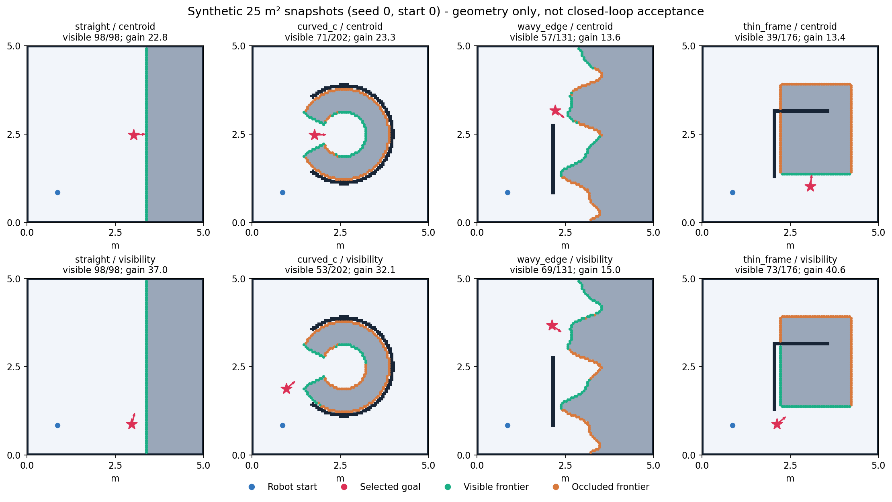

# 不规则边界自主探索：夜间本地验证

当前是试验策略，不替换默认，不推送。真车物理参数仍待测，没有连接或部署实车，没有通过任何实车关卡。

## 方法与改动

成熟实现研究见[原始论文与源码核查](2026-10-27-irregular-frontier-research.md)。采用 FUEL 的安全候选视点与射线可见性思路，仅移植二维观测选择思想；没有复制无人机运动模型。m-explore-ros2 的连通搜索可作对照，但未提供遮挡视点评分。原网格已表示不规则边缘，因此没有把障碍拟合成填满的矩形，也不人为提高分辨率。PCA分簇保留为后续独立变量，不混入这次A/B。

新增 visibility 策略在原安全候选集中，按保守supercover视线评估可见前沿及既有路径代价，朝向实际可见格。默认仍 centroid。48个候选/96个前沿格是确定性预算，状态输出是否采样与可见数。采样不足保持未探索，不构成完成证据。安全膨胀、四连通路径、八连通簇、0.35m半径、0.15m起点吸附、完成判据、SLAM参数和正式验收门限完全不变。

## 预先固定的栅格配对

4种25m²合成布局（直边、弧形C、波浪边、细边框）×3起点×5种子，共60对；种子同时决定小幅形状与起点扰动，A/B输入完全相同，运行顺序按种子交替。独立线段与封闭格方形相交oracle核验可见性，独立EDT和四连通分量核验足迹与可达。

本批“可见前沿格数/(0.5m+路径距离)”60/60提高、0退化；所有目标安全且连通、无缺目标输入。每格只有5对，提高比例的95% Wilson区间为[56.55%,100%]，不能据此声称普遍100%。全部配对来自相关合成形状，不是60次独立整屋探索。

桌面选择器：centroid P50/P95约52.6/62.6ms，visibility为68.1/81.5ms；新策略最大84.0ms。不是板上延时，未模拟真实CPU体系结构，也不涵盖Nav2与SLAM负载。

注意：弧形C起点0单次平均可见格数71→53、起点1为71→39，因路程更短，所定义收益仍提高。新策略并未在所有情况下看到更多格；是否会造成后续绕行或重复观察，必须由闭环验证判断。

原始栅格计划/逐对输入哈希/所有结果：`~/wheeltec_sim_ws/data/runs/20261027-irregular-mechanism-v1/`。源码是计划中逐文件哈希，后加回放工具不改变算法哈希。

## 真实ROS过程回放与Gazebo

历史真实ROS过程回放预定65个时间点，49个有有效输入、16个未录到。39个收益提高、3个退化、7个持平（其中4个双方无目标），目标全部通过地图内足迹/连通检查；这不证明历史错位地图中的目标在真实物理空间安全。3个退化样本无capture issue，保留如下，不能因不利而剔除：

| 历史场景/起点/时刻 | 原收益 | 新收益 | 变化 |
| --- | ---: | ---: | ---: |
| baseline/0/30s | 18.710 | 17.500 | -6.47% |
| l_shape/1/5s | 22.712 | 21.754 | -4.22% |
| clutter/1/30s | 17.838 | 14.521 | -18.60% |

原始目录 `~/wheeltec_sim_ws/data/runs/20261027-irregular-replay-v1/`。只使用记录的占据格与估计TF位姿，固定5/30/60/120/240秒，首帧无效就记缺，不寻找更好的帧；不重建历史访问点，是一步反事实选点，不能推断新轨迹。回放使用8–9号核心，与仿真0–3号核心分开；板上负载未验证。随后对全部3个反例逐簇离线复现：新策略所选目标的簇内精确可见收益未下降，但评价的全局可见收益仍有上述下降，两种指标不能互换。baseline/0/30s中有一簇23格，17个候选全部完整检查仍看不到该簇；旧目标对此簇可见0格，但能看到其他簇29格，新策略因此保留该簇未探索。该例不是预算漏采样。详见[全部反例分析](irregular-20261027/replay-regression-analysis.json)。其余局部选择与全局任务效率之间的因果仍未验证，不据此删除3个反例或盲调预算。

Gazebo使用新25m² segmented arc和thin frame布局，各起点0、5种子，realism=on，噪声1×，300秒任务预算与原评分门限。弧形由有缝的小方块构成，是分段曲边近似，不是光滑圆弧或实车测量。真值只供现有独立评估器。

正式on批次 v2 完成20次：原策略0/10、新策略0/10；每布局/策略均0/5，95% Wilson区间[0%,43.45%]。全部0个导航目标、覆盖76.05%–83.11%，20次真值有效。19次incomplete；另1次探索器日志为map_unstable/tf_stale，但评估器未收到终态，原始结果按缺终态/异常退出失败保留，不依据stdout改成成功。全部45次保留试验的最近地图选择SHA256均未变；原始进程组均无存活成员，但3次名义试验有launch内部SIGKILL，不得写成全部优雅退出。这里覆盖范围是最后实时/map；正式验收始终使用保存地图saved_map_metrics，最终表另列保存值，不能混用。

| on布局/起点 | centroid | visibility |
| --- | --- | --- |
| irregular_arc/0 | 0/5 | 0/5 |
| irregular_frame/0 | 0/5 | 0/5 |

独立EDT检查20次记录的首/末新鲜快照，共40份，最近安全中心距离为0.292–0.381m，全部超过原0.15m吸附范围，与既有有限FOV安全域阻塞一致。该审计不是缺失的精确选点时刻追踪，不能据零目标判定新策略本身失败或成功。数据见[起步审计](irregular-20261027/startup-audit.json)。名义off运动对照已预先固定同布局/起点/五种子、120秒ROS任务预算（独立于正式on的300秒），仅检验运动机制，不能计作准入通过。

开发v1首个原始试验保留；汇总在另一分支尚无样本时除零，修复仅令该格成功率显示null，另开v2完整配对。原始失败与分层诊断见[调试记录](2026-10-27-debug-irregular-viewpoints.md)。

## 复现

在WSL中source ROS与已有workspace，从项目根目录运行，所有输出必须使用新目录：

```bash
python3 -m unittest discover -s src/wheeltec_explore/test -v
python3 -m unittest discover -s simulation -p test_paired_viewpoints.py -v
python3 simulation/benchmark_viewpoints.py --output ~/wheeltec_sim_ws/data/runs/NEW-mechanism
python3 simulation/replay_viewpoints.py --output ~/wheeltec_sim_ws/data/runs/NEW-replay
python3 simulation/paired_viewpoint_batch.py --output ~/wheeltec_sim_ws/data/runs/NEW-gazebo
```

直接场景检查用 `simulation/check_exploration.py --scenario irregular_frame --viewpoint-strategy visibility --realism on --record --output <新Linux目录>`。实车不能照搬这条命令；本轮没有物理运动授权。

## 未验证与准入

实车异形障碍识别、细框漏检、雷达有效FOV和噪声、轮滑、RDK X5负载、整屋探索成功率收益仍待证据。LOS只保证当前地图中的几何无遮挡，不等于新信息、有效视场或量程。当前不建议据本补丁进入G3–G5；G0–G2按原关卡采集并校准后，再跑realism=on固定种子回归。禁止通过调验收门限换通过。

04:00续作：Windows任务 WHEELTEC-IrregularFrontier-20261028-0400，2026-10-28 04:00 +08:00；完成则静默，最近5分钟活跃心跳不重复运行，CLI带OS锁。任务已登记并检查Ready及触发时间，2项防重复/完成静默测试通过；实际到点触发尚未验证。需要电脑开机、联网和登录。


## 回归检查（当前代码）

84/84通过，10组检查覆盖：探索器36、独立几何与过程/真值27、种子计划3、退出/策略接口3、配对计划5、固定回放取帧1、ROS时间/TF3、实际ROS健康跳变1、续作守卫2、结果索引3。原始日志在 `~/wheeltec_sim_ws/data/runs/20261027-irregular-checks-v3/`，摘要见[检查索引](irregular-20261027/checks-summary.json)。旧v1/v2日志保留，独立审查重复执行的用例不叠加。网页端与实车现场检查不计入这84项。




## 已复现的保存质量反例

名义arc/seed1/visibility保存地图墙面P95=0.119853m、轮廓覆盖91.875%，独立复评分与原值完全一致，分别未达到0.10m和95%门限；保存覆盖100%且内部completed仍不算通过。返航后最后实时/map为0.085122m和98.75%，不能拿较好的实时值替换已保存工件得分。是否由于返航回环或其他SLAM更新导致改善尚未验证，本轮不改回环或保存流程。见[确定性复评分](irregular-20261027/saved-quality-replay.json)。


## 名义运动对照完整结果（off，不具准入资格）

同25m²、同起点0、同五种子、同120秒ROS任务预算，20次全部执行；每对只切换选点策略。父进程实际亲和为0–3号核，运行中context已保留。正式300秒on结果独立，不与本表合并。

| 布局 | centroid严格功能通过 | visibility严格功能通过 | 各自95% Wilson区间 |
| --- | --- | --- | --- |
| irregular_arc | 5/5 | 2/5 | [56.55%,100%] / [11.76%,76.93%] |
| irregular_frame | 5/5 | 3/5 | [56.55%,100%] / [23.07%,88.24%] |
| 合计（描述计数） | 10/10 | 5/10 | 不以合计掩盖每布局结果 |

原始harness汇总为10/10与6/10，逐份result.json原样保留。最终日志审计发现arc/seed0/visibility虽原记功能成功，但launch内部对lifecycle_manager发送SIGKILL；顶层wrapper返回0没有捕获。修复未来harness并对双方全部原日志应用同一严格退出规则后，候选为5/10。严格口径只增加失败，不改变几何、完成或安全门限；原始6/10与派生5/10分列在[45次完整索引](irregular-20261027/raw-outcome-index.json)。

候选5次严格失败全部计入：arc/seed0嵌套强杀；arc/seed1保存工件P95/轮廓覆盖失败；arc/seed3与frame/seed3在探索器启动前Nav2未激活（并有真值到达间隙失效）；frame/seed4以tf_stale终止，未保存地图。内部completed、较好的返航后/map、单步收益提高均不能替代这些失败。

frame/seed4失败快照中，隔离4核选择器5次重复的旧/新中位耗时约48.6/66.2ms，最大51.2/70.0ms。这不支持“该快照单次函数独自耗时超过1秒”，但不能排除与SLAM/Nav2并发下的调度/回调积压，根因未验证。未增加TF时限或改发布频率。[原始快照剖析](irregular-20261027/recorded-selector-profile.json)。

结论：visibility修复了地图内盲视目标选择，合成及回放局部指标有收益，但本次闭环功能计数下降，且尚未证明启动异常由策略导致。保留显式试验接口、默认centroid，不推广为更可靠算法。后续应先处理运行时稳定性与校准，再做单独的全局观测/路线收益试验；不能凭此次单步分数宣称成功率提高。

## 运行时复现与停止边界

冻结批次后的4个运行时异常，各按原seed、扰动pose、模式、时长及CPU限制独立复现一次，不替换原试验，也不混入5种子通过率。on/arc seed1原tf_stale此次变为incomplete；off/arc seed3原Nav2未激活此次completed且功能通过；off/frame seed3原Nav2未激活此次completed但保存几何仍未达标；off/frame seed4原tf_stale此次completed且功能通过。4个原症状均未复现，按约定记录后停止该诊断，不修改TF时限、SLAM、DDS或CPU参数猜测修复。见[全部复现结果](irregular-20261027/runtime-reproductions-summary.json)。新发现的arc/seed0退出漏洞已由原始launch日志确定性复现并修复验证器；其launch运行时挂起根因未验证。

## 交付边界与追溯

本轮真实Gazebo试验45次：开发v1一份、正式on二十份、名义off二十份、隔离复现四份，全部保留。65个历史回放时点与60对合成输入另列，不能相加称为整屋成功次数。全部45份的4个核心算法文件、realism/SLAM/Nav2/bridge配置、模型及独立map_metrics评分哈希一致。运行harness在最后追加子进程强杀拒绝检查，因此它与旧试验哈希不同，索引明确标false；这是验收漏洞修复，不冒充原始运行版本。默认算法仍centroid，未据局部收益推广候选。

[环境末次核查](irregular-20261027/environment-audit.json)显示隔离测试域84/88/89无残留进程。原始日志中的强杀仍保留，当前无进程不代表历史全部正常退出。全部latest.json哈希保持一致。没有连接、部署或驱动实车，物理数据与板上表现均未验证。

本地分支 `work/irregular-frontiers-20261027`；算法、测试、实验驱动、退出修复及证据文档分项提交，见 `git log b4a1d37..HEAD --oneline`。遵照最新指令，未push、未建PR。次日04:00任务仍保留；本轮有限实验与审计完成后状态置completed，届时守卫静默退出，实际到点唤醒未验证。

完整名义对照复现（不能当准入，输出必须新目录）：

```bash
python3 simulation/paired_viewpoint_batch.py --realism off --task-timeout 120 --timeout 280 --output ~/wheeltec_sim_ws/data/runs/NEW-nominal
python3 setup/verification/irregular-20261027/run_checks.py --output ~/wheeltec_sim_ws/data/runs/NEW-checks
```

结论：本轮完成了候选方法实现与可复核的负结果，尚未实现整体成功率提高。正式on的起始安全域阻塞先于选点；名义off候选更差。下一轮应在实测校准和可复现的运行时证据基础上分开处理，不能通过放宽安全域或验收来宣布优化成功。
