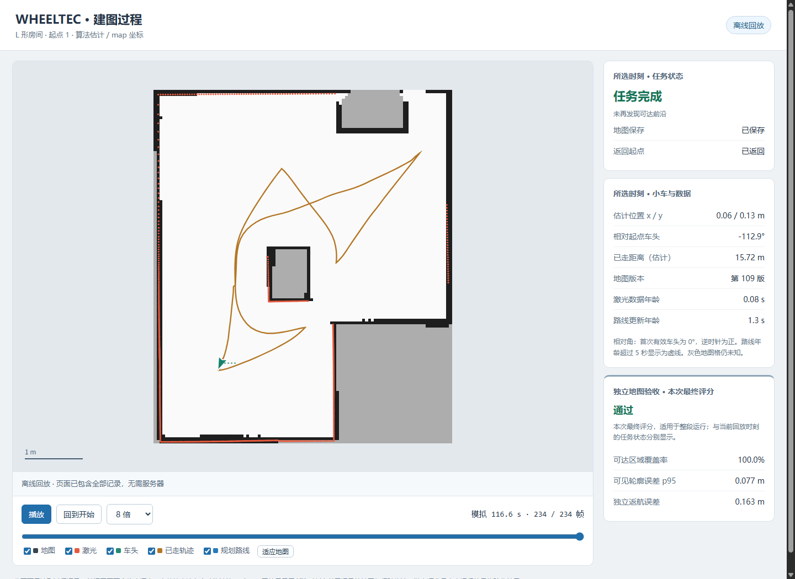

# 陌生房间验证记录

本轮完成仿真验证与实车迁移准备。实车尚不可连接，没有部署或实车运动测试。

## 已修复的问题

- 真值停止更新：评分前固定任务终点，核对Gazebo源时间戳、任务期间的最大采样间隙和终点年龄。无效时返航误差、安全几何数据为不可用，验收失败。[实际记录断流重放](truth-dropout-replay.json)
- 过期TF：记录原TF时间戳，按仿真年龄及实际停更时长判定；过期时位置置空，轨迹停止追加。实际ROS发布端停止后已验证。[断流记录](stale-tf-integration.json)
- 未知栅格重载：所有保存入口将free_thresh统一为0.19，实际Nav2保存/加载仍为 `[-1,0,100]`。[往返测试](map-roundtrip.json)
- 斜向前沿被切碎：仅聚类改用八邻域，安全路径仍用四邻域；45度边界回归和禁止斜穿障碍角测试通过。

## 过程查看器

[浏览器检查结果](viewer-browser-check.json) 使用最终批次的L形起点1真实记录，共234帧、109版地图。Chrome验证首帧/中间帧/尾帧、播放暂停、8倍速、图层开关及记录停更。离线回放实际用file://打开，页面无需服务器。[停更与断线专项](viewer-stream-boundaries.json) 进一步确认：只修改文件mtime不会冒充新记录，服务断开后仍保留最后地图和轨迹。算法估计地图、轨迹与任务状态按时刻选择；独立验收在单独卡片显示本次最终评分。

## 迁移检查工具

[真实Gazebo录包重放](interfaces-bag-replay.json) 中，最终只读工具检测到激光约10Hz、里程计约29.4Hz，测量时间戳递增，最后激光时间上的TF可用。[100ms延迟TF专项](interfaces-delayed-tf.json) 也通过。采样结束后最多等0.5秒，让TF补齐同一份最后激光数据；不继续追逐新激光。

这些是仿真接口检查，`deployment_ready`仍为false。现场使用步骤与未测项目见 [robot/README.md](../../../robot/README.md) 和 [现场测量表](../../../robot/现场测量表.md)。

## 多房间批次

[13组结果表](matrix.md) 和 [完整结果索引](matrix.json)：最终真值有效13/13，内部completed为2/13，独立验收通过1/13。通过项为L形起点1：正确空地覆盖100%，墙面95分位7.7cm，返航16.3cm。

多数未完成项仍有无法解决的前沿；弯通道起点0与凹角起点2的覆盖率分别约65.8%和59.4%，地图及返航误差超过2米。弯通道起点1虽报告completed，墙面95分位仍为79.4cm。下一阶段需要改善这些实际算法表现。

[原始13组](original-batch.json) 中有两组真值失效：大型过程JSON写入阻塞采集，以及ROS时钟回调落后。读取改为独立进程、终态作有界时钟同步后，按相同算法和门限将这两组固定重跑一次，真值均有效；重跑仍有算法未完成或地图超限，见 [两组重跑](truth-reruns.json)。原始失败没有覆盖，也没有按表现挑选最好结果。

修复前诊断批次保留在 [prior-diagnostic-batch.json](prior-diagnostic-batch.json)，含斜前沿错误和一次Nav2 lifecycle启动失败。曾被普通入口并发测试改变的最近地图选择，已从原metadata副本按原SHA256完全恢复；此后批次与普通入口串行验证。

完整数据：Linux `/home/wheeltec/wheeltec_sim_ws/data/runs/20261023-validation-suite-final`，重跑为 `20261024-validation-truth-reruns`。每组包含process、truth、result、map、bag和日志；源码目录仅保留小型结果与截图。评分定义和复现命令见 [validation.md](../../../simulation/validation.md)。

## 回归与复审

[78项Python/ROS回归及Node检查](regressions.json) 全部通过；[真值进程红绿测试与来源](truth-worker-regressions.json) 保留原失败和修复后结果。[独立复审](validation-review.md) 包括原两项P2、时钟同步、半行读取、首进程先死及子进程忽略中断的退出路径。[静态检查](static-checks.json) 和 [PowerShell解析](powershell-parse.json) 记录语法、文档链接、编码与六个入口。

## 普通操作入口

[普通入口实测](normal-session.json) 从L形起点1启动探索，内部completed后确认停车，再手动存图。停止后仅凭latest启动定位，生成世界的SHA256与之前相同，场景身份和起点保持一致，AMCL活动并恢复估计位置。记录196帧、97版地图，离线replay约9.2MB，录制器正常退出；所有自有进程无强杀和存活残留。该检查核对入口衔接，不另算独立地图质量通过。

最近地图选择在测试后按原始字节恢复，SHA256仍为 `46fe655145eceeb53d0882f7c56cc22714553eea0e9c563c475055409c9ca1c6`。完整日志与手动保存成果位于Linux `data/runs/20261024-normal-session-check`，过程目录见结果中的capture_run。

日常使用：双击根目录 `启动_自主探索建图.cmd`，选择布局和起点；网页自动打开。结束后可打开本次 `replay.html`。随后使用 `启动_已有地图导航.cmd`，地图旁的仿真身份文件会恢复对应布局与起点。

本轮交付源码的精确工作区SHA256及普通入口原始结果哈希见 [source-hashes.json](source-hashes.json)；每组真正运行时的源码哈希仍保留在matrix.json。
